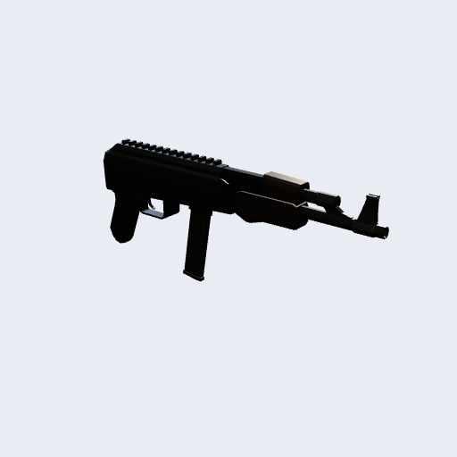
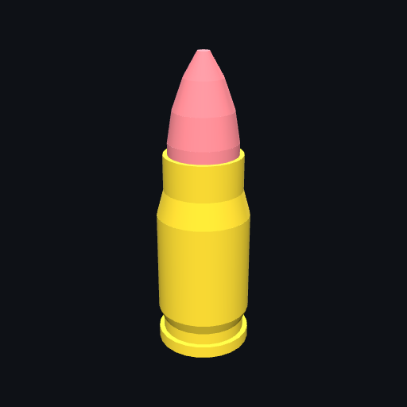
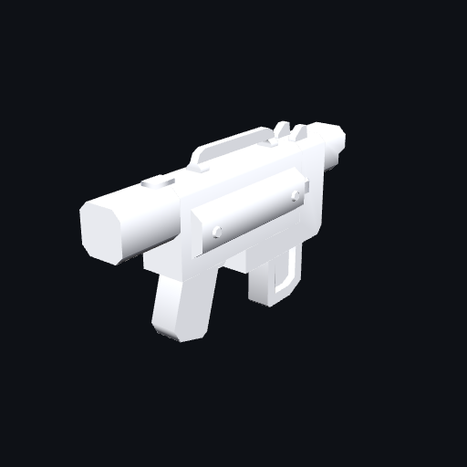
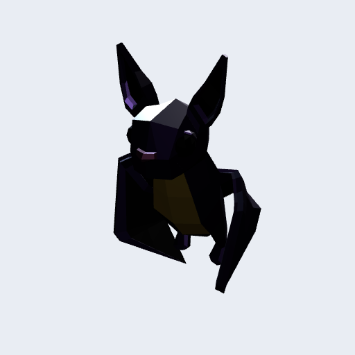
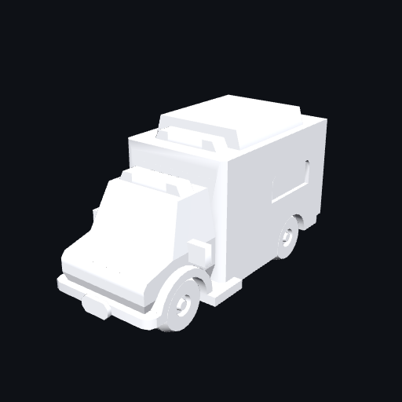
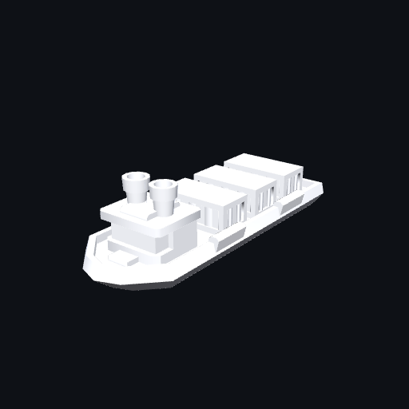
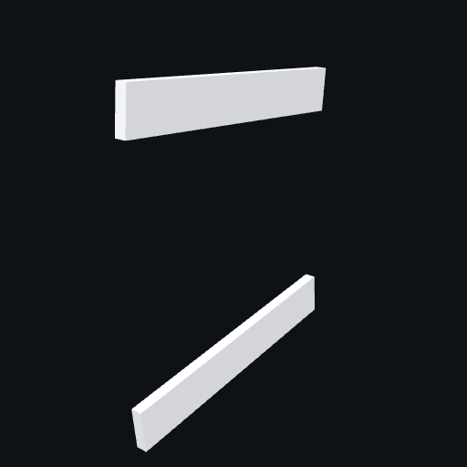
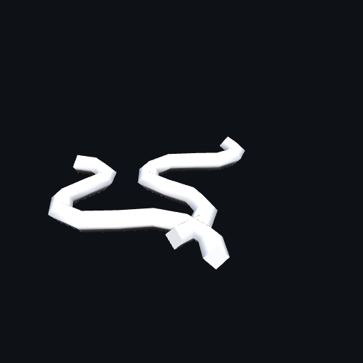

# Shooter Asset Library 🔫

> **3,309 free, game-ready 3D models for shooter / FPS games** — weapons, characters,
> enemies, vehicles, city & nature environments, sci-fi kits and props. Every model
> ships as a single self-contained **.glb** (glTF 2.0), with a **rendered preview
> image** and a **live interactive 3D viewer**. All assets are **CC0 / public domain**.

**🌐 Browse the interactive gallery:** https://touhid-hz.github.io/shooter-asset-library/

## Highlights

|  |  |  |
|---|---|---|
| <a href="viewer.html?src=assets/weapons/q-guns50-assaultrifle-1.glb"></a><br><sub>q guns50 assaultrifle 1</sub> | <a href="viewer.html?src=assets/weapons/k-weapon-ammo-machinegun.glb"></a><br><sub>k weapon ammo machinegun</sub> | <a href="viewer.html?src=assets/weapons/k-blaster-blaster-a.glb"></a><br><sub>k blaster blaster a</sub> |
| <a href="viewer.html?src=assets/characters/k-blocky-characters-character-a.glb"></a><br><sub>k blocky characters character a</sub> | <a href="viewer.html?src=assets/enemies/q-monsters-bat.glb"></a><br><sub>q monsters bat</sub> | <a href="viewer.html?src=assets/vehicles/k-car-ambulance.glb"></a><br><sub>k car ambulance</sub> |
| <a href="viewer.html?src=assets/vehicles/k-watercraft-ship-cargo-a.glb"></a><br><sub>k watercraft ship cargo a</sub> | <a href="viewer.html?src=assets/buildings/k-building-barricade-doorway-a.glb"></a><br><sub>k building barricade doorway a</sub> | <a href="viewer.html?src=assets/nature/k-mini-forest-tree.glb"></a><br><sub>k mini forest tree</sub> |
| <a href="viewer.html?src=assets/sci-fi/k-modular-space-cables.glb"></a><br><sub>k modular space cables</sub> |

*(click any preview to open it in the interactive 3D viewer)*

## What's inside

3,309 models across 9 categories: **buildings** 901 · **nature** 614 · **sci fi** 516 · **vehicles** 480 · **props** 440 · **prototype** 145 · **weapons** 132 · **characters** 65 · **enemies** 16.

| Category | Models | Contents |
|---|---:|---|
| [buildings](https://touhid-hz.github.io/shooter-asset-library/) | 901 | city buildings, modular streets, factories,graveyards |
| [nature](https://touhid-hz.github.io/shooter-asset-library/) | 614 | trees, rocks, plants, stylized nature kits |
| [sci fi](https://touhid-hz.github.io/shooter-asset-library/) | 516 | space stations, modular sci-fi interiors, rails |
| [vehicles](https://touhid-hz.github.io/shooter-asset-library/) | 480 | cars, tanks, boats, trains, spaceships |
| [props](https://touhid-hz.github.io/shooter-asset-library/) | 440 | furniture, food, survival gear, market props |
| [prototype](https://touhid-hz.github.io/shooter-asset-library/) | 145 | greybox blocks for rapid level design |
| [weapons](https://touhid-hz.github.io/shooter-asset-library/) | 132 | rifles, machine guns, pistols, sci-fi blasters, turrets |
| [characters](https://touhid-hz.github.io/shooter-asset-library/) | 65 | humanoid characters, robots, base rigs |
| [enemies](https://touhid-hz.github.io/shooter-asset-library/) | 16 | zombies, monsters, animated enemies |

## Why this library?

- **Real production catalogs** — models from [Kenney](https://kenney.nl) and
  [Quaternius](https://quaternius.com), the two most trusted names in free
  game assets. Optimized low-poly meshes that run fast on any platform.
- **One format, zero friction** — every model is a single `.glb` file:
  drag-and-drop into Unity, Unreal, Godot, Blender or Three.js. No texture
  folders to reconnect.
- **Preview everything instantly** — each of the 3,309 models has a rendered
  preview, and the gallery site loads any model in a full 3D viewer with
  orbit / zoom / auto-rotate.
- **Truly free** — CC0 means: use, modify, and ship in commercial games
  with **no attribution required**. (We still credit the authors because
  they deserve it.)

## Repository layout

```text
shooter-asset-library/
├── index.html               ← gallery (GitHub Pages)
├── viewer.html              ← interactive 3D viewer
├── assets/manifest.json     ← full machine-readable index
├── assets/<category>/*.glb  ← 3,309 models
├── previews/<category>/*.png← rendered preview for every model
├── ATTRIBUTION.md
└── LICENSE
```

## Using the assets

| Engine | How |
|---|---|
| **Unity** | Drag the `.glb` into the project (2020+ imports glTF natively; otherwise use glTFast) |
| **Unreal 5** | Enable the *glTF Interchange* importer, then drag & drop |
| **Godot 4** | Copy into the project — `.glb` imports automatically |
| **Three.js** | `new GLTFLoader().load('assets/weapons/…glb', …)` |
| **Blender** | File → Import → glTF 2.0 |

## Sources & licenses

- **Kenney blaster** — 40 models
- **Kenney blocky-characters** — 18 models
- **Kenney building** — 79 models
- **Kenney car** — 50 models
- **Kenney city-commercial** — 41 models
- **Kenney city-industrial** — 25 models
- **Kenney city-roads** — 72 models
- **Kenney city-suburban** — 40 models
- **Kenney factory** — 143 models
- **Kenney food** — 200 models
- **Kenney furniture** — 140 models
- **Kenney graveyard** — 91 models
- **Kenney mini-characters** — 26 models
- **Kenney mini-forest** — 22 models
- **Kenney mini-market** — 20 models
- **Kenney modular-buildings** — 108 models
- **Kenney modular-space** — 40 models
- **Kenney nature** — 329 models
- **Kenney prototype** — 145 models
- **Kenney racing** — 112 models
- **Kenney retro-urban** — 124 models
- **Kenney space** — 153 models
- **Kenney space-station** — 97 models
- **Kenney survival** — 80 models
- **Kenney toy-car** — 157 models
- **Kenney train** — 103 models
- **Kenney watercraft** — 46 models
- **Kenney weapon** — 37 models
- **Quaternius 150-lowpoly-nature-models** — 150 models
- **Quaternius 50-lowpoly-guns** — 55 models
- **Quaternius Toon Shooter Game Kit** — 16 models
- **Quaternius animated-easy-enemies** — 6 models
- **Quaternius downtowncitymegakit** — 153 models
- **Quaternius lowpoly-animated-monsters** — 4 models
- **Quaternius lowpoly-cars** — 7 models
- **Quaternius lowpoly-modular-street** — 25 models
- **Quaternius lowpoly-robot** — 1 models
- **Quaternius lowpoly-spaceships** — 5 models
- **Quaternius modular-sci-fi-megakit** — 189 models
- **Quaternius sci-fi-essentials-kit** — 37 models
- **Quaternius stylized-nature-megakit** — 68 models
- **Quaternius textured-lowpoly-trees** — 45 models
- **Quaternius universal-base-characters** — 10 models

All packs are released under **CC0 1.0** (public domain) by their authors —
[Kenny Vervacke (Kenney)](https://kenney.nl) and [Quaternius](https://quaternius.com).
See [ATTRIBUTION.md](ATTRIBUTION.md) for the full per-pack breakdown.

## Star this repo ⭐

If this library saves you time, starring the repo helps other devs find it.
